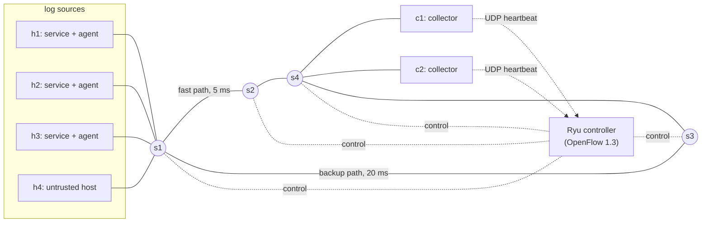

# SDN-Assisted Distributed Log Aggregation over TCP

A log aggregation system (services -> agents -> collectors -> database) that runs on **raw TCP sockets** inside a
**Mininet** network controlled by a **Ryu (OpenFlow 1.3) SDN controller**. The controller reacts to link failures,
collector failures, floods and unauthorised hosts. Every dynamic feature is compared with a **static baseline**
controller.

## The problem

Services on many machines write their own logs. A central system must collect them without losing or duplicating
any, even when a link breaks, a collector dies, or an attacker floods the network. With ordinary static forwarding
rules, any of those events stops the log stream until a human intervenes.

## Architecture



Agents connect to a **virtual IP** (`10.0.0.100:9000`). The controller decides which real collector serves each TCP
connection. Collectors report their health and load to the controller with UDP heartbeats to a second virtual
address; the heartbeat arrives at the controller as an OpenFlow packet-in. This is the link between the socket
application and the SDN network.

## Components

| Part | File | What it does |
|---|---|---|
| Services | `app/service.py` | Write JSON logs with unique id and sequence number |
| Agent | `app/agent.py` | TCP client: batching, checkpoint, reconnect, retry with backoff, connection rotation |
| Collector | `app/collector.py` | TCP server (one thread per connection), acknowledges **after** the database commit, backpressure, heartbeats |
| Protocol | `common/protocol.py` | Message framing: 4-byte length + JSON |
| Flooder | `app/flooder.py` | UDP flood generator (the attack) |
| Dashboard API | `app/query_api.py` | Read-only HTTP API that merges both collectors' databases and serves the controller's events |
| Dashboard | `ui/` (optional) | Web dashboard: live logs, filters, alert banner |
| Controller | `sdn/controller.py` | Ryu OpenFlow 1.3 app, `static` or `dynamic` mode |
| Controller logic | `sdn/model.py` | Shortest-path routing, collector pool, flood detector (unit tested) |
| Topology | `sdn/topo.py` + `config/topology.json` | Mininet network and application launcher |
| Experiments | `experiments/` | Runs all scenarios in both modes, computes metrics, draws graphs |

### TCP protocol

Every message is `[4-byte length][JSON]`. Agent to collector: `{"type":"batch","logs":[...]}`. Replies:
`ack` (logs are committed to the database), `busy` (overloaded, retry later), `error` (invalid or temporary).
The agent moves its checkpoint forward only after an `ack`, so a log is never confirmed while it exists only in
memory. Every log has a unique id, so a resend after a failure is harmless.

## What the controller does

| Mode | Behaviour |
|---|---|
| **static** (baseline) | Routes on the fast path installed once; the virtual IP always maps to collector c1; no reaction to anything |
| **dynamic** | 1. **Link failure:** port-status event, shortest paths recomputed, routing table updated<br>2. **Load balancing:** first packet of every TCP connection goes to the controller, which picks the least-loaded live collector and installs NAT rules<br>3. **Health checks and failover:** no heartbeat for 1.5 s means the collector is dead, its rules are removed and reconnecting agents are sent to the other one<br>4. **Access control:** only authorised sources may use the virtual IP<br>5. **Flood defence:** port byte counters are polled every second; a host above 3 Mbit/s for 2 samples is quarantined for 30 s |

OpenFlow pipeline: table 0 is the classifier (NAT, ACL, quarantine, punt to controller), table 1 routes by
destination IP. Rerouting therefore only touches table 1 and the NAT rules never need to change.

## Install (Ubuntu 22.04 or 24.04)

```
git clone <this repository>
cd <repository>
bash scripts/install_ubuntu.sh
source .venv/bin/activate
sudo mn --test pingall          # must end with 0% dropped
python3 tests/test_model.py     # unit tests of the controller logic
```

## Run

Open four terminals in the project folder (activate the environment in each: `source .venv/bin/activate`).

| Terminal | Command |
|---|---|
| 1. Controller | `mkdir -p results/demo` then `SDN_MODE=dynamic EVENT_LOG=results/demo/controller_events.jsonl ryu-manager sdn/controller.py` |
| 2. Network + applications | `sudo $(which python3) sdn/topo.py --demo` (gives a `mininet>` prompt) |
| 3. Dashboard API (optional) | `python3 app/query_api.py --run-dir results/demo --events results/demo/controller_events.jsonl` |
| 4. Dashboard (optional) | `cd ui && npm install && npm run dev`, open the address it prints and click **Live API** |

If your machine has no Open vSwitch kernel module, add `--datapath user` to the command in terminal 2.
The demo starts every source at 2 logs per second so the dashboard stays readable (`--rate 10` for more traffic).

The dashboard is optional: it makes the live demo easier to follow, but everything (logs, failover, graphs) also
works without it. The dashboard code is the web UI from the earlier version of this project; it only needs an API
at `http://127.0.0.1:8000` that answers `GET /logs` and `GET /stats`, which `app/query_api.py` provides.

Smoke test (needs the controller running in terminal 1):
```
sudo $(which python3) tests/smoke_mininet.py
```

## Live demo script

At the `mininet>` prompt:

| Step | Command | What to point out |
|---|---|---|
| Show the rules | `flows s1` | Table 0: NAT rules per connection. Table 1: routes |
| Balanced collectors | `sh grep -c connected results/demo/collector_c1.out results/demo/collector_c2.out` | Both collectors serve agents |
| Link failure | `link s1 s2 down` | Logs keep flowing over s3; check `flows s1` again |
| Collector failure | `kill_collector c1` | Agents reconnect to c2 within seconds |
| Flood | `flood 20` | h4 is quarantined after about 2 s (controller log: `flood_block`) |
| Unauthorised host | `rogue` | h4's connection is dropped (controller log: `acl_block`) |
| Watch it live | dashboard in the browser | Logs keep arriving during every failure |
| Delivery check | `sh python3 experiments/analysis.py --run-dir results/demo` | 0 logs missing |

Stop the services first and wait a few seconds before the delivery check, so the agents can finish sending.

## Experiments: static vs dynamic

```
sudo $(which python3) experiments/run_experiments.py          # about 12 minutes, all scenarios
python3 experiments/plot_results.py                            # graphs in results/plots/
```
Results are written to `results/summary.csv`. Scenarios: `normal`, `link_failure`, `collector_failure`, `flood`,
`rogue`. Metrics: goodput (logs per second the collectors confirmed), recovery time, 95th percentile delivery
delay, logs undelivered at the end, share per collector, rogue logs accepted, controller detection and reaction time.

| Scenario | Static controller | Dynamic controller |
|---|---|---|
| Link failure | [fill from summary.csv] | [fill from summary.csv] |
| Collector failure | [fill] | [fill] |
| UDP flood | [fill] | [fill] |
| Unauthorised host | [fill] | [fill] |
| Load balance (normal run) | [fill] | [fill] |

All components run on one machine, so the figures show the behaviour of the design, not the limits of real hardware.

## Reproducing the results

Everything needed is in this repository: topology (`config/topology.json`, `sdn/topo.py`), controller
(`sdn/`), application (`app/`, `common/`), tests (`tests/`), experiment scripts (`experiments/`) and install
scripts (`scripts/`). The commands above reproduce all results on a fresh Ubuntu machine.

## Mapping to the evaluation criteria

| Criterion | Where |
|---|---|
| Problem and architecture | This README, architecture diagram |
| TCP socket implementation | `app/collector.py`, `app/agent.py`, `common/protocol.py`: framing, threads, timeouts, error handling, reconnect |
| Mininet and SDN | `sdn/topo.py`, `config/topology.json`, `sdn/controller.py`: two-table OpenFlow pipeline |
| Socket and SDN integration | Heartbeats from collectors become packet-in events; the controller steers new connections by collector load and health |
| Dynamic SDN | Rerouting, load balancing, failover, access control, flood blocking |
| Challenging scenarios | Link failure, collector kill, UDP flood, unauthorised host |
| Performance evaluation | `experiments/`: static baseline against dynamic controller under five conditions |

## Limitations and future work

- SQLite and one thread per connection limit the throughput of a single collector.
- The topology and host table come from a configuration file; discovering them with LLDP would make the controller
  work on arbitrary networks.
- Possible extensions: QoS queues that prioritise log traffic, TLS on the log connections, several controllers for
  high availability.
